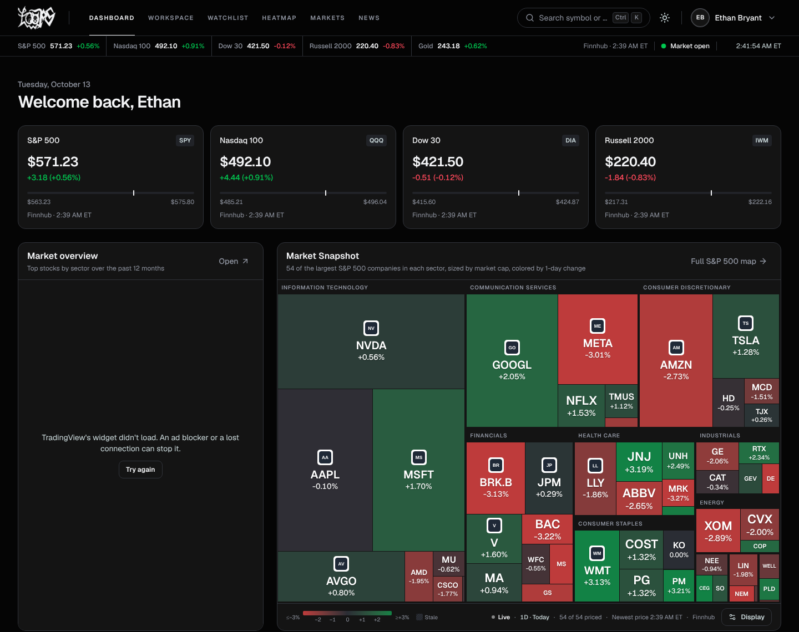
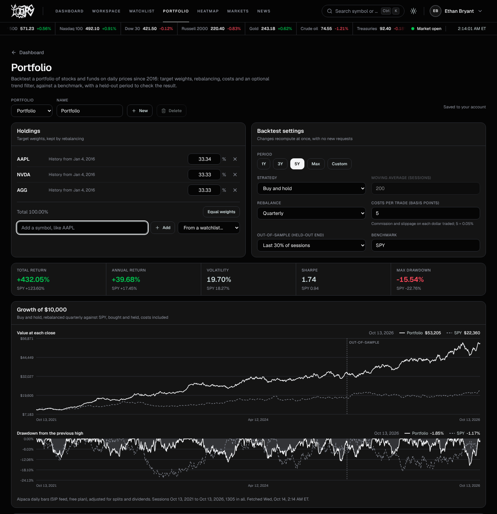
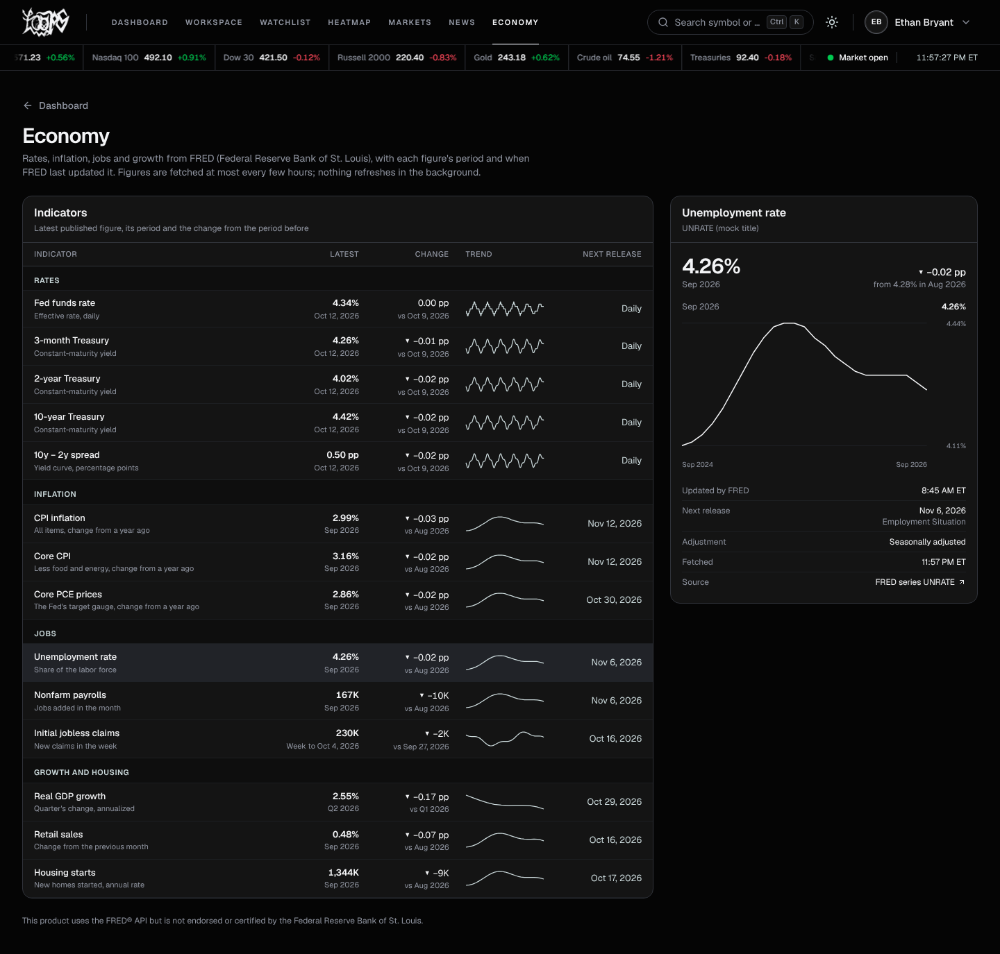
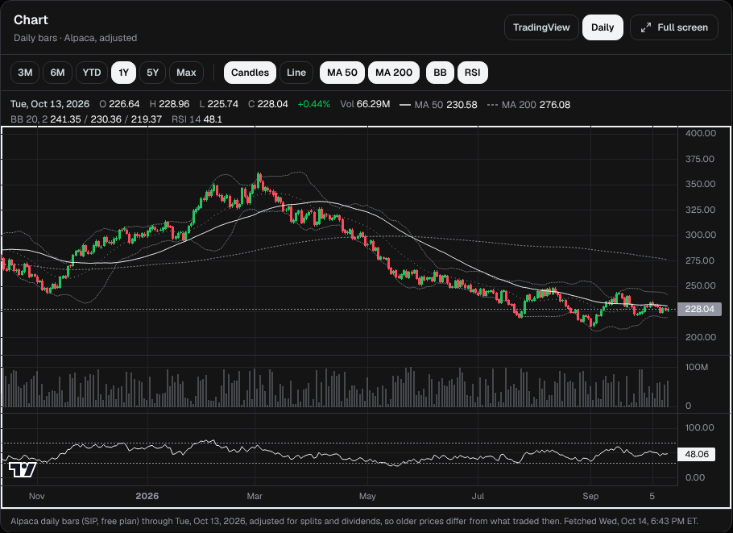

# Loops Watch

A personal stock research workstation: live market dashboard, customizable widget workspaces, watchlists, a stock
screener, US economic indicators, a portfolio backtester and daily charts with technical indicators. It runs entirely
on free data plans, with every provider request budgeted and cached so the app stays inside each free rate limit.

**Live:** [loops-watch.vercel.app](https://loops-watch.vercel.app) (sign-in is limited to approved emails; see
[Access](#access))



<sub>Screenshots use sample data.</sub>

## Features

- **Dashboard:** S&P 500, Nasdaq 100, Dow 30 and Russell 2000 tiles, a live market strip with the session status
  and New York clock, a market news panel, and the **Market Snapshot**: a treemap heatmap of 54 large S&P 500
  companies drawn with custom layout code and updated from Finnhub's live trade stream.
- **Workspaces:** drag-and-resize widget layouts (charts, quotes, news, watchlist, heatmap, screener, economic
  indicators, upcoming Fed and data releases) with a linked symbol across widgets. Saved per account.
- **Stock pages:** price, key figures, company news, profile and financials, plus a **Daily chart** built on
  Lightweight Charts with candles, volume, 50/200-day moving averages, Bollinger Bands and RSI.
- **Watchlists:** multiple named lists in a sortable, filterable quote grid with chosen columns, drag reordering,
  undo and a details panel.
- **Markets screener:** TradingView's US screener with presets, and a native screener over your watchlists with
  figure filters and saved presets.
- **News:** market, M&A, watchlist and earnings feeds with search and bookmarks, and an upcoming-events calendar
  built from the Federal Reserve, BLS and BEA public schedules.
- **Economy:** 14 US indicators from FRED (rates, inflation, jobs, growth and housing) with trends and next release
  dates.
- **Portfolio backtester:** target-weight portfolios against a benchmark with rebalancing, trading costs, an optional
  trend filter and an out-of-sample split. No look-ahead: decisions use prior closes and fill at the next open.
- **Data status page:** provider calls per minute and hour, cache hit share, queue and pauses.
- **Emails:** an AI-written welcome email (Gemini) and a daily watchlist news summary, scheduled with Inngest.
- Light and dark themes, keyboard navigation (Ctrl/⌘K symbol search), and responsive layouts down to phone width.

| Portfolio backtest | Economy |
|---|---|
|  |  |



## Tech stack

| Area | Tools |
|---|---|
| Framework | Next.js 16 (App Router, Server Components, server actions), React 19, TypeScript |
| UI | Tailwind CSS 4, Base UI / shadcn components, cmdk, React Grid Layout, Lightweight Charts, TradingView embeds |
| Auth and data | Better Auth, MongoDB Atlas with Mongoose |
| Market data | Finnhub (quotes, profiles, news, WebSocket trades), Alpaca (daily bars), FRED (economic series), Fed/BLS/BEA calendars |
| Background jobs | Inngest, Gemini, Nodemailer |
| Testing | Vitest unit tests for the pure financial, market-calendar and layout logic; scripts that verify real provider data |
| Hosting | Vercel |

## Engineering highlights

- **One request gate for every provider** (`lib/providers/gate.ts`). Each provider has a sliding per-minute budget
  set under its free limit, with user-facing requests ahead of background refreshes, merged duplicate requests,
  stale-while-revalidate caching, a pause after HTTP 429, and slow answers persisted in MongoDB with a TTL index.
  A cold dashboard that used to send ~170 Finnhub calls now never exceeds 50 in any 60 seconds.
- **Market-session aware caching** (`lib/market-calendar.ts`, `lib/market-data.ts`). Exchange holidays, early closes
  and daylight saving are handled in New York time, so quote refreshes stop after the close and nights and weekends
  cost no requests.
- **Honest data labels.** Every price carries its source and age ("Finnhub · 10:41 AM ET", "Cached", "Delayed"), and
  missing values show "—" instead of being estimated.
- **Deterministic, tested calculations.** Returns, moving averages, Bollinger Bands, RSI (checked against a published
  worked example), backtest statistics and treemap layout are pure modules covered by unit tests in `tests/`.
- **Security.** Provider keys stay on the server and never reach the browser bundle, every API route and server
  action checks the session, and sign-in is rate limited per address and per email.

More detail: [architecture](docs/architecture.md), [data providers and limits](docs/providers.md),
[heatmap data sources](docs/heatmap.md).

## Access

Finnhub's free plan is licensed for personal use, so the deployed site only lets emails listed in `ALLOWED_EMAILS`
sign up or sign in. Everyone else sees the sign-in page with a note that the site is private. To try it yourself, run
it locally with your own free keys.

## Run it locally

1. Install [Node.js](https://nodejs.org) 22 or newer.
2. Copy `.env.example` to `.env` and fill in the values. Comments in the file say where to get each free key, and
   put your own email in `ALLOWED_EMAILS`.
3. Install and start:

   ```bash
   npm install
   npm run dev
   ```

4. Open http://localhost:3000 and sign up with the email from `ALLOWED_EMAILS`.
5. Optional, for the emails: run Inngest's local server in a second terminal.

   ```bash
   npx inngest-cli@latest dev -u http://localhost:3000/api/inngest
   ```

### Checks

```bash
npm test                    # unit tests
npx tsc --noEmit            # type check
npm run lint
npm run build
npm run check:market-data   # verifies real Finnhub data with your key
npm run check:fred          # verifies real FRED data with your key
npm run check:portfolio     # verifies real Alpaca daily bars with your keys
```

## Deploy

Everything runs on free tiers (Vercel Hobby, MongoDB Atlas, Inngest). The step-by-step guide is
[docs/deploy.md](docs/deploy.md).

## Credits

The project started from the [JavaScript Mastery "Signalist" tutorial](https://www.youtube.com/watch?v=gu4pafNCXng)
(auth, search, stock pages and the news email) and was then extended into the workstation above. Market data from
Finnhub, Alpaca and FRED; charts by TradingView. This product uses the FRED® API but is not endorsed or certified by
the Federal Reserve Bank of St. Louis.
